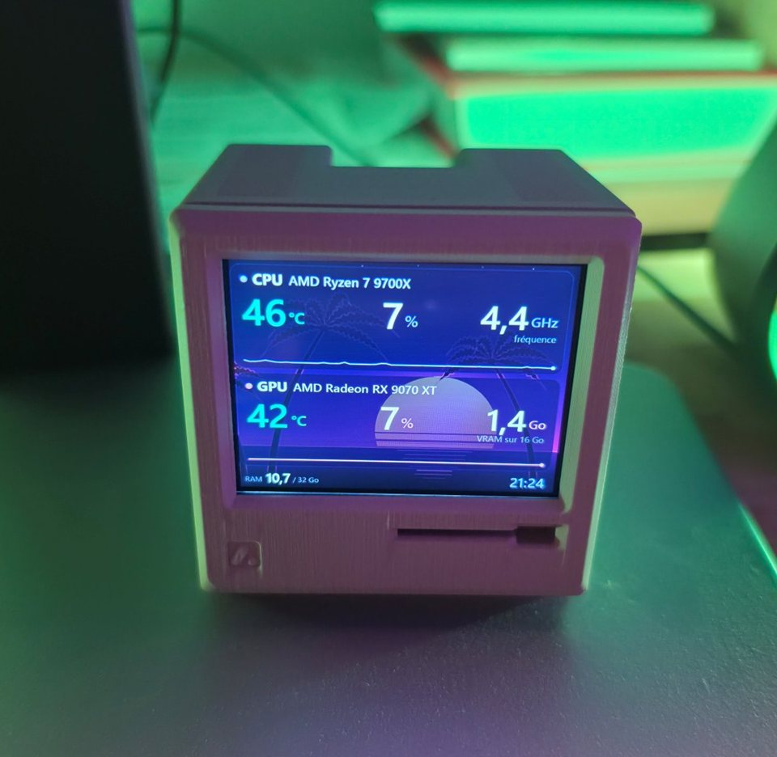
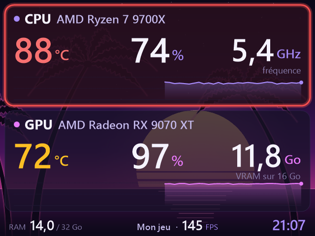
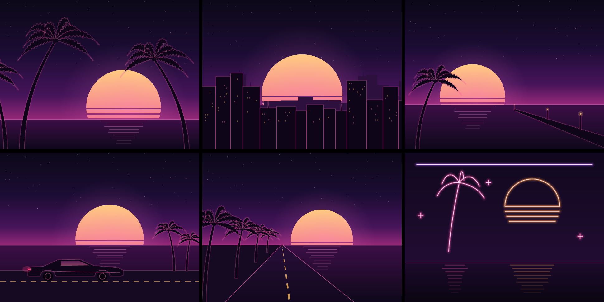

# Moniteur CPU / GPU

> 🤖 **Application entièrement créée par [Claude](https://claude.ai) (Anthropic)**, avec [Claude Code](https://claude.com/claude-code),
> à partir des idées et des retours de [Ciwil25](https://github.com/Ciwil25).

Petit tableau de bord pour un **écran secondaire** (pensé pour un écran **640x480**) qui affiche en direct, en gros et lisible de loin :

- **CPU** : température, utilisation, fréquence, courbe d'utilisation sur 60 s
- **GPU** : température, utilisation, mémoire vidéo utilisée, courbe d'utilisation sur 60 s
- **RAM** utilisée, **heure**, et **FPS + nom du jeu** quand un jeu est au premier plan
- **Alerte** : la carte passe au rouge et « respire » au-dessus d'un seuil (85 °C par défaut)
- **6 fonds d'écran** rétro années 80 au choix (ou aucun)

<p align="center">
  
  <br><em>En vrai, sur un petit écran 640x480 dans un boîtier rétro (fond « Palmiers »)</em>
  <br>Boîtier imprimé en 3D : <a href="https://makerworld.com/fr/models/801209-mini-retro-screen-mini-retro-screen">Mini Retro Screen sur MakerWorld</a>
</p>



*(capture en mode démo : surchauffe du CPU simulée)*

### Fonds d'écran

Palmiers, Ville, Jetée, Voiture rétro, Route côtière et Néon, tous dessinés par le programme dans des tons violet, magenta, orange et rose.
Le choix se fait dans **Paramètres → Fond d'écran**, avec un aperçu.



## Télécharger et lancer

1. Téléchargez le fichier **`Moniteur-CPU-GPU.zip`** dans la page [**Releases**](../../releases/latest).
2. Faites clic droit sur le zip → **Extraire tout**, et placez le dossier où vous voulez (par ex. dans *Documents*).
3. Double-cliquez sur **`Moniteur.exe`** et acceptez la demande d'autorisation de Windows.

Et c'est tout : rien d'autre à installer.

> **« Windows a protégé votre ordinateur » ?** L'application n'est pas signée par un éditeur connu.
> Cliquez sur **Informations complémentaires → Exécuter quand même**.

### Au premier lancement

- Si le petit pilote gratuit **PawnIO** n'est pas installé, le moniteur propose de le télécharger
  (depuis [sa page officielle](https://github.com/namazso/PawnIO.Setup)) et de l'installer.
  Il sert uniquement à lire la **température et la fréquence du CPU** ; sans lui, tout le reste fonctionne.
- Une icône violette apparaît à côté de l'horloge de Windows.

## Utilisation

**Icône violette** (à côté de l'horloge, éventuellement derrière la petite flèche **^**) :

| Action | Effet |
|---|---|
| Survol | Températures et utilisations en résumé |
| Clic gauche | Afficher / masquer le moniteur |
| Clic droit → **Paramètres…** | Écran, plein écran ou fenêtre, taille, fond d'écran, seuil d'alerte, démarrage |
| Clic droit → **Lancer au démarrage de Windows** | Le moniteur s'ouvre tout seul à chaque session |
| Clic droit → **Quitter** | Ferme complètement le moniteur |

Sur le moniteur : **Échap** ou **double-clic** le masquent ; en mode fenêtre, on peut le **déplacer** à la souris.
Le moniteur ne peut pas être réduit par erreur (jeu plein écran, Windows + D) : il se remet tout seul à sa place.

## Paramètres

Les réglages sont enregistrés dans **`parametres.ini`**, à côté de `Moniteur.exe`. Le plus simple est de passer par
**clic droit sur l'icône → Paramètres…**, mais le fichier se modifie aussi à la main :

```ini
[affichage]
; auto = cherche un écran 640x480, ou le nom Windows de l'écran, ex. \\.\DISPLAY2
ecran = auto
; plein = plein écran sur l'écran choisi, fenetre = fenêtre de taille fixe
mode = plein
largeur = 640
hauteur = 480
x = 100
y = 100
; fond = palmiers, ville, jetee, voiture, route, neon ou aucun
fond = palmiers
[alerte]
seuil_alerte = 85
```

L'affichage s'adapte à **n'importe quelle résolution** (800x480, 1024x600, 1920x1080…) en gardant ses proportions.

## Matériel

- Un petit écran secondaire branché au PC (testé avec un écran **640x480**).
- Le boîtier rétro de la photo : modèle 3D **[Mini Retro Screen](https://makerworld.com/fr/models/801209-mini-retro-screen-mini-retro-screen)**
  sur MakerWorld (modèle de son auteur, non inclus dans ce projet).

## Bon à savoir

- **Windows 10 / 11, 64 bits.** Fonctionne avec les processeurs et cartes graphiques AMD, NVIDIA et Intel.
- L'application demande les **droits administrateur** : c'est nécessaire pour lire les capteurs. Un antivirus peut
  parfois la signaler pour cette raison ; c'est habituel pour ce type d'outil.
- Les **pourcentages et la fréquence** sont calculés comme dans le **Gestionnaire des tâches**.
- Les **FPS** n'apparaissent que pour un **jeu** au premier plan : navigateurs, Discord, Spotify, lanceurs (Steam, EA app,
  Epic…) et le bureau sont ignorés.

## Modifier l'appli avec Claude

Pas besoin de savoir programmer : l'application a été entièrement écrite par Claude, et elle peut être modifiée de la même façon.

1. Sur cette page GitHub, cliquez sur le bouton vert **Code → Download ZIP**, puis extrayez le zip.
   Il faut **tout le dossier** (le code, les scripts `build` et le fichier `CLAUDE.md`), pas seulement un fichier.
2. Ouvrez ce dossier dans **[Claude Code](https://claude.com/claude-code)** (application Claude, onglet *Code*, ou en ligne de commande).
3. Demandez ce que vous voulez, en français, par exemple :
   - « Ajoute la vitesse des ventilateurs de la carte graphique »
   - « Crée un nouveau fond avec une plage et un coucher de soleil »
   - « Adapte l'affichage pour mon écran en 800x480 »
4. Claude lit automatiquement le fichier **`CLAUDE.md`** : il y trouve le rôle de chaque fichier, la façon de compiler
   et les pièges déjà rencontrés. Il peut ensuite recompiler `Moniteur.exe` avec les scripts du dossier `build`.

## Compiler soi-même

Aucun outil à installer : le compilateur C# est fourni avec Windows.

```powershell
.\build\dependances.ps1   # télécharge LibreHardwareMonitorLib et ses dépendances (nuget.org)
.\build\compiler.ps1      # produit bin\Moniteur.exe
```

Pour les FPS, placez [`PresentMon.exe`](https://github.com/GameTechDev/PresentMon/releases) (version x64) à côté de `Moniteur.exe`.

## Licences et crédits

**Conception et code : [Claude](https://claude.ai) (Anthropic)**, via Claude Code. Idées, tests et retours : [Ciwil25](https://github.com/Ciwil25).

Code de ce projet : licence **MIT** (voir [LICENSE](LICENSE)).

Ce projet s'appuie sur des logiciels libres, dont les licences sont détaillées dans [THIRD-PARTY-NOTICES.md](THIRD-PARTY-NOTICES.md) :

- [LibreHardwareMonitor](https://github.com/LibreHardwareMonitor/LibreHardwareMonitor) (MPL-2.0) : lecture des capteurs
- [PresentMon](https://github.com/GameTechDev/PresentMon) d'Intel (MIT) : mesure des FPS
- [PawnIO](https://github.com/namazso/PawnIO.Setup) : pilote téléchargé à la demande, non inclus
